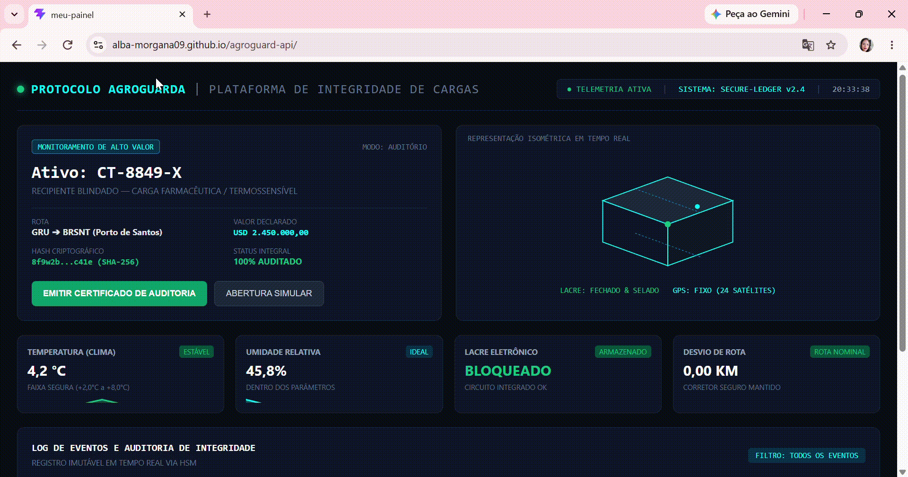

# 🌾 AgroGuard — Proteção e Monitoramento de Cargas em Tempo Real

> Uma plataforma intuitiva criada para acompanhar o transporte de mercadorias valiosas e sensíveis (como remédios e alimentos), garantindo segurança do início ao fim da rota.

---

## 📸 Como a Plataforma Funciona

👉 **[Clique aqui para testar o sistema ao vivo no seu navegador!](https://alba-morgana09.github.io/agroguard-api/)**

---

## 🎯 Para que serve o AgroGuard?

Imagine que uma empresa precisa transportar um caminhão cheio de vacinas ou remédios caros de um estado para outro. Se a temperatura subir ou se alguém tentar abrir o caminhão no caminho, a carga pode ser perdida.

O **AgroGuard** resolve esse problema ao funcionar como um **painel de controle central** que avisa em tempo real:

* 🌡️ **Se a temperatura está correta:** Garante que a carga não estrague.
* 🔒 **Se o lacre está fechado:** Alerta imediatamente em caso de tentativa de violação.
* 📍 **Se o veículo está no trajeto certo:** Acompanha o deslocamento por GPS.
* 📑 **Emissão de Certificados:** Confirma que a entrega seguiu todas as regras de segurança.

---

## 💻 Tecnologias do Projeto

Para quem é da área de tecnologia, este projeto foi desenvolvido utilizando:

* **React + TypeScript:** Para criar uma interface rápida, moderna e segura.
* **Tailwind CSS:** Para o visual estilizado no formato de centro de operações.
* **GitHub Pages:** Para manter o sistema rodando online de forma contínua.

---

## ✍️ Autoria e Direitos

Desenvolvido por **Alba Morgana dos Santos Benicio**.  
Projeto protegido sob a **Licença MIT**.

* **Perfil no GitHub:** [@alba-morgana09](https://github.com/alba-morgana09)
* **LinkedIn:** [Perfil Profissional](https://www.linkedin.com/in/albamorgana/)
