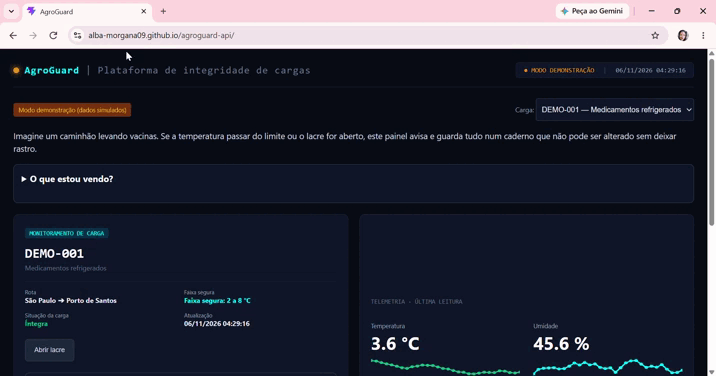

# 🌾 AgroGuard — Protótipo de Monitoramento de Cargas

> Dashboard frontend visual para apresentar o monitoramento de cargas sensíveis. O projeto é um protótipo construído com React, TypeScript e Vite, com dados simulados; **não é uma API** e não possui integração com sensores, GPS ou banco de dados.

## 📸 Demo



👉 **[Acessar a demo no GitHub Pages](https://alba-morgana09.github.io/agroguard-api/)**

## 🎯 Sobre o projeto

O dashboard representa uma central de acompanhamento de uma carga farmacêutica termossensível. A interface exibe informações como temperatura, umidade, status do lacre, desvio de rota e eventos de auditoria.

Essas informações são demonstrativas e estão definidas no próprio frontend. O projeto não recebe dados externos nem envia requisições para uma API.

## 💻 Tecnologias

- React
- TypeScript
- Vite
- React DOM
- CSS e estilos inline
- GitHub Pages para publicação da demo

## 🚀 Como executar

Requisitos: Node.js e npm.

```bash
npm ci
npm run dev
```

Para gerar o build de produção:

```bash
npm run build
```

Para visualizar localmente o build gerado:

```bash
npm run preview
```

## 📁 Estrutura principal

```text
.
├── public/                 # Arquivos públicos e ícones
├── src/
│   ├── assets/             # Imagens e SVGs
│   ├── App.tsx             # Componente raiz
│   ├── DashboardIntegridade.tsx
│   ├── App.css
│   ├── index.css
│   └── main.tsx            # Inicialização do React
├── .github/workflows/
│   └── deploy.yml          # Build e publicação no GitHub Pages
├── index.html
├── package.json
└── vite.config.ts
```

## ✅ Implementado

- Dashboard visual de monitoramento de cargas.
- Exibição de dados estáticos de temperatura, umidade, GPS, rota e auditoria.
- Relógio atualizado no frontend.
- Simulação de abertura e bloqueio do lacre.
- Micrográficos SVG para os indicadores exibidos.
- Build e publicação no GitHub Pages.

## 🗺️ Planejado

- Integração com o repositório [`agroguard`](https://github.com/alba-morgana09/agroguard).
- Carregamento de logs por API.
- Testes automatizados do frontend.
- Melhorias de responsividade para diferentes tamanhos de tela.

## ✍️ Autoria

Desenvolvido por **Alba Morgana dos Santos Benicio**.

- [Perfil no GitHub](https://github.com/alba-morgana09)
- [LinkedIn](https://www.linkedin.com/in/albamorgana/)
